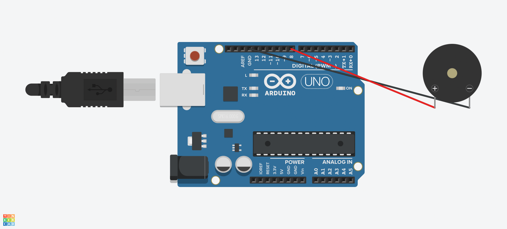

# Melody with passive buzzer and Arduino

Simple project that plays a melody using a passive buzzer and the Arduino's tone() function.

## Materials

1 × Arduino MEGA 2560 (or compatible) 
1 × Passive Buzzer 
2 × Jumper Cables 
1 x USB cable to power and program the board

## Connections

Buzzer Arduino MEGA 
Pin + Pin digital 8 
Pin - GND

## How it works

Each note is a frequency in Hz. The program runs through two arrays: melody[], with the frequencies, and durations[], with the duration of each note (2 = half note, 4 = quarter note). For each note it calls tone (pin, frequency, duration) and leaves a 30% pause between notes so that they are distinguished.

Note Frequency (Hz) 
C5 523 
Db5 554 
F5 698 
G5 784 
A5 880 
Bb5 932
